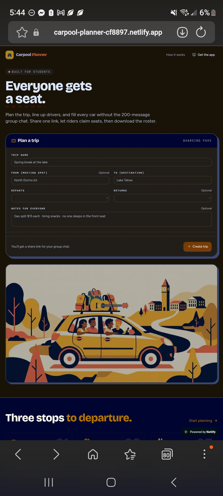

# Carpool Planner

Carpool Planner helps students organize shared rides — dorm runs, game days, spring break — without a
200-message group chat. An organizer creates a trip and shares one link. Drivers add their cars and open seats,
riders claim a seat or join the waitlist, and one tap auto-fills everyone who's still waiting. When the plan is
set, the whole trip downloads as a spreadsheet, a calendar invite, a printable trip sheet, or a text summary for
the group chat. The app itself is installable on phones and laptops.

## Features

- **Plan a trip** — name, meeting spot, destination, departure/return times, and notes.
- **Cars and seats** — each driver lists passenger seats, where they leave from, and a contact. Every car shows
  as a top-down seat map.
- **Riders** — add riders with a pickup spot; seat them directly, move them between cars, or leave them on the
  waitlist.
- **Auto-fill** — seats waitlisted riders, matching pickup spots to a driver's starting point first, then
  spreading the rest evenly.
- **Downloads** — roster CSV, `.ics` calendar invite with a 30-minute reminder, print / save-as-PDF trip sheet,
  plain-text summary, and copy-to-clipboard for group chats.
- **Install the app** — a web-app manifest and service worker make it installable, and recently viewed pages
  stay available offline.
- **Your trips** — the home page remembers trips opened in this browser.

## Tech stack

- [TanStack Start](https://tanstack.com/start) (React 19, file-based routing, server functions)
- Tailwind CSS 4 with shadcn/ui components (Radix UI)
- [Netlify Database](https://docs.netlify.com) (managed Postgres) via Drizzle ORM
- Netlify Image CDN for the generated artwork and app icons
- Deployed on Netlify

## Run locally

```bash
pnpm install
netlify dev            # runs the app with Netlify Database emulation
```

`netlify dev` is recommended so server functions can reach the database. Database migrations live in
`netlify/database/migrations/` and are applied automatically on deploy.

After changing `db/schema.ts`, generate a migration:

```bash
npx drizzle-kit generate --name <describe_the_change>
```

## Ideas for later
- Optional organizer passcode so only the organizer can edit trip details or remove cars
- Recurring trips and round-trip seat lists
- Gas/cost split per rider
- Live updates while the board is open

## How to Install and Run
1. Open Live Demo in your browser: https://carpool-planner-cf8897.netlify.app

2. Or download the code, open index.html in your browser
On mobile Chrome, tap 3 dots > Add to Home Screen to install as app

3. Look at the code and scroll down to see the download button.


## Live Demo
https://carpool-planner-cf8897.netlify.app

## GitHub Repository
https://remrcaluzadevp.github.io/My-Portfolio/

## Author
Remiellene R. Caluza 

BSINTE 2A 

## Screenshot



